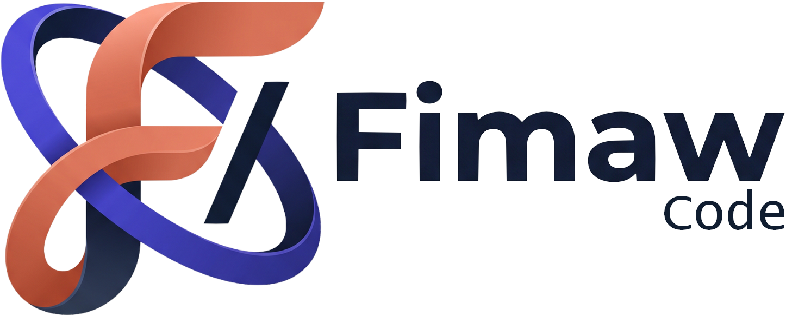

  

  <b>The Intelligent Desktop Agent & Workspace</b> 
  Owned & Developed by <a href="https://fimaw.com"><b>Fimaw LLC</b></a>

  
  
  

---

## 🚀 About FimawCode

**FimawCode** is a next-generation intelligent agent desktop environment designed for developers, researchers, and creators. Built with high performance and modular architecture, FimawCode combines local file capabilities, robust process management, and multi-model AI intelligence into an intuitive, native desktop application.

### Key Capabilities
- **Multi-Platform Native Applications**: Official packages for Windows (x64), macOS (Apple Silicon & Intel), and Linux.
- **Full Agent Autonomy**: Autonomous coding, task planning, file operations, web research, and project navigation.
- **Privacy-First Architecture**: Your local workspaces, codebases, and credentials remain securely on your machine.
- **Extensible Plugin Ecosystem**: Fully pluggable subsystem engine enabling customized workflows and extensions.

---

## 📥 Downloads & Releases

Ready-to-install desktop releases and updates are published under [**Releases**](https://github.com/FimawLLC/FimawCode/releases):

| Operating System | Package Format | Download Link |
| :--- | :--- | :--- |
| **Windows** | .exe (Installer) | [Latest Windows Installer](https://github.com/FimawLLC/FimawCode/releases) |
| **macOS (Apple Silicon)** | .dmg | [Latest macOS arm64](https://github.com/FimawLLC/FimawCode/releases) |
| **macOS (Intel)** | .dmg | [Latest macOS x64](https://github.com/FimawLLC/FimawCode/releases) |
| **Linux** | .AppImage | [Latest Linux AppImage](https://github.com/FimawLLC/FimawCode/releases) |

---

## 🏢 Official Information

- **Company**: Fimaw LLC
- **Official Website**: [https://fimaw.com](https://fimaw.com)
- **Official Emails**:
  - General Inquiries: [info@fimaw.com](mailto:info@fimaw.com)
  - Contact: [contact@fimaw.com](mailto:contact@fimaw.com)
  - Product & Engineering: [code@fimaw.com](mailto:code@fimaw.com)
- **GitHub Organization**: [https://github.com/FimawLLC](https://github.com/FimawLLC)

---

## 📄 License & Intellectual Property

Copyright © 2026 **Fimaw LLC**. All rights reserved.
Official distribution channel for compiled desktop packages.